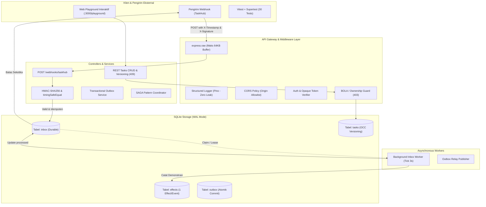

# 🚀 TaskHub API Development - Training Hari 3
**Kurikulum Resmi NQA: Webhook, Microservices, Pengujian, dan Proyek End-to-End**

Selamat datang di repository pembelajaran resmi **API Development Training - Hari 3**.
Repository ini dibangun secara komprehensif untuk mengimplementasikan dan membuktikan **seluruh 69 slide presentasi pelatihan Hari 3**, menjembatani konsep teoretis ke dalam kode operasional siap uji pada stack **Node.js 20+, Express, SQLite (WAL Mode), Pino, Vitest, dan Supertest**.

---

## 🌟 Fitur Utama & Pembuktian Slide

1. **📨 Webhook Receiver & Verifikasi HMAC (Slide 9 – 34)**:
   - Endpoint `POST /webhooks/taskhub` dengan pembacaan Buffer byte asli (`express.raw({ limit: "64kb" })`) sebelum parsing JSON (Slide 19 & 20).
   - Tanda tangan kriptografis HMAC-SHA256 dari `timestamp.rawBody` dengan perbandingan waktu-konstan `crypto.timingSafeEqual` anti-Timing Attack (Slide 11 & 21).
   - Pembatasan Replay Window berbasis timestamp toleransi 300 detik (Slide 13 & 20).
   - Deduplikasi event identik (**202 Accepted, duplicate=true**) dan deteksi modifikasi/tampering hash (**409 Conflict**) (Slide 15 & 33).

2. **📥 Pola Durable Inbox & Background Worker (Slide 17 – 27)**:
   - Menjamin prinsip *"Jangan kirim 2xx sebelum tersimpan durabel ke database"* (Slide 17).
   - Skema tabel `inbox` berpenegakan `UNIQUE(provider, event_id)` anti-race condition (Slide 18 & 24).
   - Worker asinkron dengan koordinasi *Claim/Lease*, pencatatan efek demonstrasi ke tabel `effects`, penanganan retry bertahap, dan simulasi *Dead Letter Queue (DLQ)* (Slide 25 & 26).

3. **🔄 Komunikasi Microservice: Outbox & SAGA Simulator (Slide 35 – 40)**:
   - Pencegahan *Dual Write Problem* melalui pola **Transactional Outbox** yang mengikat penyimpanan Task dan Outbox Event dalam satu transaksi basis data atomik (Slide 38).
   - Simulasi celah publisher crash yang membuktikan mengapa consumer tetap wajib idempoten (Slide 39).
   - Simulasi pola **SAGA** (Reservasi &rarr; Bayar &rarr; Konfirmasi) dilengkapi alur **Transaksi Kompensasi** saat pembayaran ditolak (Slide 40).

4. **🧪 Otomasi Pengujian & Workflow 14 Langkah (Slide 41 – 52)**:
   - **30 Skenario Uji Otomatis** menggunakan Vitest + Supertest pada `tests/auth.test.js`, `tests/tasks.test.js`, `tests/security.test.js`, dan `tests/webhooks.test.js` (Slide 44 & 47).
   - Runner interaktif **Workflow 14 Langkah** Postman/Insomnia: Login, CRUD, Optimistic Concurrency Control (409), BOLA Violation (403), Mass Assignment (422), Idempotency Key notifikasi, dan Cleanup (Slide 48).
   - Matriks 15 skenario uji keamanan deterministik (Slide 50).

5. **📊 Observabilitas & Kesiapan Produksi (Slide 53 – 58)**:
   - *Structured Logging* Pino tanpa kebocoran (*Zero-Leak*): Mencatat `requestId`, `method`, `path` tanpa query, `status`, dan `latencyMs`. **Tidak pernah mencetak token, password, body, atau signature!** (Slide 54).
   - Probe diagnostik orkestrator kontainer: `/health/liveness` dan `/health/readiness` (Slide 57).
   - Pengukuran latensi persentil p50, p95, p99, dan pemantauan backlog antrean inbox (Slide 52 & 55).

6. **🎨 Web Playground Interaktif Modern**:
   - Antarmuka web glassmorphism dark-mode yang elegan diakses melalui browser pada `http://127.0.0.1:3000/playground`.
   - Dilengkapi Live HMAC Studio, visualizer status sirkuit, pemeriksa tabel SQLite real-time, dan log stream.

---

## 🏛️ Diagram Arsitektur Sistem



---

## 📁 Struktur Direktori Repository

```text
API-Development-3/
├── .env.example                     # Templat konfigurasi lingkungan
├── .env                             # Konfigurasi lingkungan aktif lokal
├── package.json                     # Konfigurasi dependensi dan skrip npm
├── openapi.yaml                     # Kontrak formal OpenAPI 3.0 (Contract-First)
├── postman_collection.json          # Koleksi 14 langkah pengujian Postman/Insomnia
├── postman_environment.json         # Variabel lingkungan Postman lokal
├── PANDUAN_INSTALASI.md             # Panduan instalasi dan persiapan lingkungan
├── README.md                        # Dokumentasi utama proyek
│
├── bahan_ajar/                      # 10 Modul Bahan Ajar Lengkap (Bedah 69 Slide)
│   ├── README.md                    # Silabus dan peta belajar mandiri
│   ├── 00_ringkasan_hari_3_dan_alur_end_to_end.md
│   ├── 01_webhook_fondasi_dan_kontrak_delivery.md
│   ├── 02_verifikasi_hmac_dan_raw_body.md
│   ├── 03_at_least_once_deduplikasi_dan_hash_conflict.md
│   ├── 04_durable_inbox_worker_dan_dlq.md
│   ├── 05_komunikasi_microservice_outbox_dan_saga.md
│   ├── 06_pengujian_api_vitest_supertest_dan_workflow_14_langkah.md
│   ├── 07_observability_operasi_dan_kesiapan_produksi.md
│   ├── 08_proyek_unit_kerja_evaluasi_dan_rencana_30_60_90.md
│   └── 09_glosarium_dan_kamus_istilah.md # Kamus kosakata sulit terlengkap
│
├── playground/                      # Web Playground Interaktif Modern
│   ├── index.html                   # Antarmuka web glassmorphism dark-mode
│   ├── style.css                    # Desain sistem responsif modern
│   └── app.js                       # Logika interaktif live polling & studio
│
├── src/                             # Kode Sumber Aplikasi Backend (Dokumentasi Tiap Lini)
│   ├── config.js                    # Validasi konfigurasi Zod (Fail-Fast)
│   ├── db.js                        # SQLite driver (better-sqlite3) & skema tabel
│   ├── logger.js                    # Structured logging Pino tanpa leak kredensial
│   ├── app.js                       # Perakitan Express app dan middleware
│   ├── server.js                    # Entrypoint server HTTP dan worker
│   ├── worker.js                    # Standalone background worker process
│   ├── middleware/
│   │   ├── auth.js                  # Autentikasi opaque token SHA-256 (401)
│   │   ├── bola.js                  # Pencegahan BOLA / IDOR kepemilikan task (403)
│   │   ├── cors.js                  # Kebijakan peramban CORS allowlist
│   │   └── rateLimiter.js           # Pembatas laju permintaan (429)
│   ├── routes/
│   │   ├── auth.js                  # Endpoint login pengguna
│   │   ├── tasks.js                 # CRUD task, OCC versioning, dan idempotency
│   │   ├── webhooks.js              # Endpoint webhook receiver express.raw
│   │   ├── health.js                # Liveness, readiness, dan metrik operasi
│   │   └── lab.js                   # API pendukung Web Playground
│   ├── schemas/
│   │   ├── auth.js                  # Skema validasi login
│   │   ├── events.js                # Skema validasi kontrak event webhook
│   │   └── tasks.js                 # Skema task anti-mass-assignment
│   └── services/
│       ├── webhookService.js        # Logika verifikasi HMAC & deduplikasi inbox
│       ├── workerService.js         # Pemrosesan event inbox dan efek demonstrasi
│       ├── outboxService.js         # Implementasi Transactional Outbox pattern
│       └── sagaService.js           # Orkestrasi SAGA & transaksi kompensasi
│
├── scripts/                         # Skrip Pengujian & Laboratorium CLI
│   ├── seed.js                      # Inisialisasi basis data awal
│   ├── send_event.js                # Skrip kirim event bertanda tangan 2x (Slide 29)
│   ├── check_db.js                  # Inspeksi tabel inbox & effects (Slide 32)
│   └── run_negative_tests.js        # Pengujian 5 skenario negatif webhook (Slide 33)
│
└── tests/                           # Pengujian Otomatis Terintegrasi (Vitest)
    ├── auth.test.js                 # 5 Uji otentikasi dan penolakan token
    ├── tasks.test.js                # 11 Uji CRUD, BOLA, dan versioning
    ├── security.test.js             # 6 Uji kontrol input, CORS, dan health
    └── webhooks.test.js             # 8 Uji HMAC, stale timestamp, dan dedup
```

---

## ⚡ Langkah Cepat Memulai (Quickstart)

### 1. Prasyarat Lingkungan
- Node.js versi 20.x atau lebih baru (`node -v`).
- NPM versi 9.x atau lebih baru (`npm -v`).

### 2. Instalasi Dependensi
```bash
npm install
```

### 3. Inisialisasi Basis Data Awal
```bash
npm run seed
```

### 4. Menjalankan Otomasi Pengujian (Vitest)
Pastikan seluruh 30 skenario uji lulus:
```bash
npm test
```

### 5. Menjalankan Server Aplikasi
```bash
npm start
```
Server akan aktif di `http://127.0.0.1:3000`.

### 6. Membuka Web Playground Interaktif
Buka peramban (*browser*) Anda dan akses:
👉 **[http://127.0.0.1:3000/playground](http://127.0.0.1:3000/playground)**

---

## 🧪 Panduan Pengujian Melalui Terminal CLI

Selain melalui Web Playground, Anda dapat menguji seluruh skenario langsung dari terminal:

### A. Uji Pengiriman Event Bertanda Tangan 2 Kali (Slide 29 & 31)
Buka jendela terminal baru saat server sedang berjalan:
```bash
npm run send:event
```
*Output yang diharapkan:*
- Pengiriman ke-1: `HTTP 202 Accepted, { accepted: true, duplicate: false }`
- Pengiriman ke-2: `HTTP 202 Accepted, { accepted: true, duplicate: true }`

### B. Inspeksi Basis Data SQLite (Slide 32)
```bash
npm run check:db
```
Mencetak isi tabel `inbox` dan tabel `effects` secara langsung.

### C. Menjalankan 5 Uji Negatif Webhook (Slide 33)
```bash
npm run test:negative
```
Menguji penolakan tanda tangan palsu (400), timestamp kedaluwarsa (400), event type salah (422), taskId bukan string (422), dan konflik hash ID sama (409).

---

## 📚 Akses Cepat Modul Pembelajaran
- [Silabus & Peta Modul](file:///Users/sulaimansaleh/Documents/API-Development-3/bahan_ajar/README.md)
- [Modul 01: Webhook & Kontrak TaskHub](file:///Users/sulaimansaleh/Documents/API-Development-3/bahan_ajar/01_webhook_fondasi_dan_kontrak_delivery.md)
- [Modul 02: HMAC & Raw Body Verification](file:///Users/sulaimansaleh/Documents/API-Development-3/bahan_ajar/02_verifikasi_hmac_dan_raw_body.md)
- [Modul 03: At-Least-Once Delivery & Deduplikasi](file:///Users/sulaimansaleh/Documents/API-Development-3/bahan_ajar/03_at_least_once_deduplikasi_dan_hash_conflict.md)
- [Modul 04: Durable Inbox & Background Worker](file:///Users/sulaimansaleh/Documents/API-Development-3/bahan_ajar/04_durable_inbox_worker_dan_dlq.md)
- [Modul 05: Microservices Outbox & SAGA](file:///Users/sulaimansaleh/Documents/API-Development-3/bahan_ajar/05_komunikasi_microservice_outbox_dan_saga.md)
- [Modul 06: Vitest & Workflow 14 Langkah](file:///Users/sulaimansaleh/Documents/API-Development-3/bahan_ajar/06_pengujian_api_vitest_supertest_dan_workflow_14_langkah.md)
- [Modul 07: Observabilitas & Checklist Produksi](file:///Users/sulaimansaleh/Documents/API-Development-3/bahan_ajar/07_observability_operasi_dan_kesiapan_produksi.md)
- [Modul 08: Panduan Proyek & Rencana 30/60/90 Hari](file:///Users/sulaimansaleh/Documents/API-Development-3/bahan_ajar/08_proyek_unit_kerja_evaluasi_dan_rencana_30_60_90.md)
- [Modul 09: Kamus Kosakata & Glosarium Lengkap](file:///Users/sulaimansaleh/Documents/API-Development-3/bahan_ajar/09_glosarium_dan_kamus_istilah.md)
